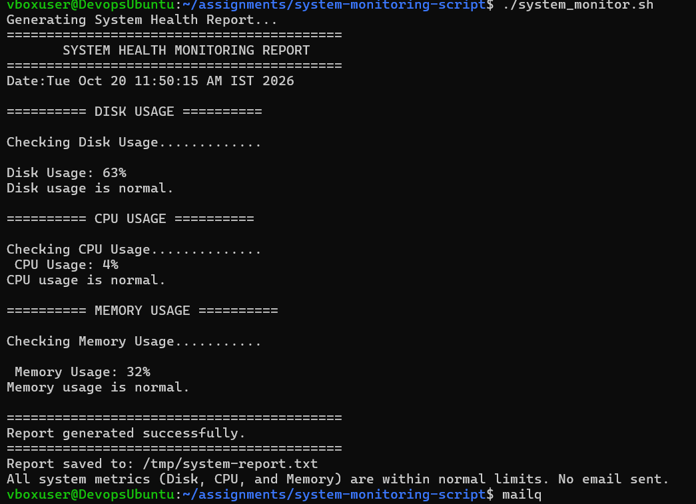
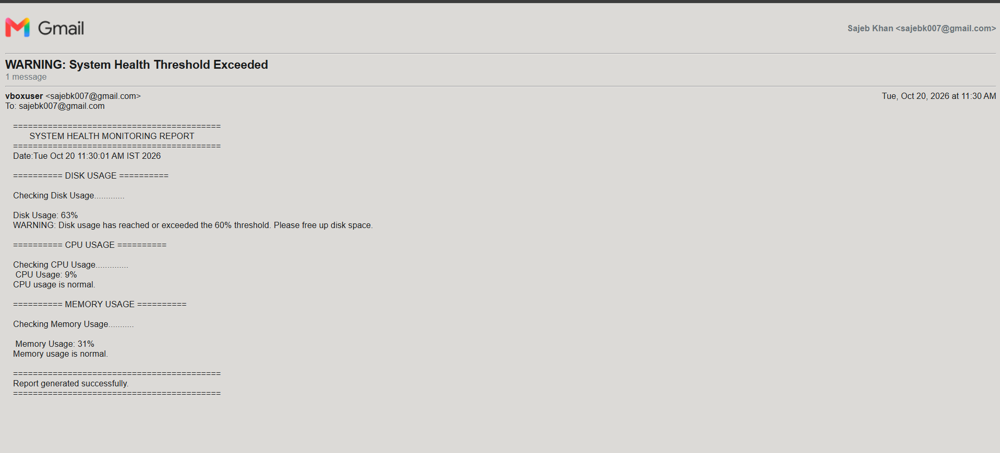

# System Monitoring Script


A lightweight Bash script that checks **CPU, memory and disk usage** on a Linux server, writes a timestamped health report, and **sends an email alert only when a threshold is breached**. Designed to run unattended through `cron`.

---

## Table of Contents

- [Features](#features)
- [How It Works](#how-it-works)
- [Tech Stack](#tech-stack)
- [Project Structure](#project-structure)
- [Prerequisites](#prerequisites)
- [Installation](#installation)
- [Configuration](#configuration)
- [Usage](#usage)
- [Scheduling with Cron](#scheduling-with-cron)
- [Sample Output](#sample-output)
- [Screenshots](#screenshots)
- [Known Limitations](#known-limitations)
- [Roadmap](#roadmap)
- [Author](#author)

---

## Features

- **Three core health checks**: CPU, memory and root-filesystem disk usage, each reported as a percentage.
- **Configurable thresholds**: defaults are 85% for CPU, 90% for memory and 90% for disk.
- **Smart alerting**: an email is sent only if at least one metric crosses its threshold, so there is no inbox noise when the system is healthy.
- **Persistent report**: every run writes a formatted report to `/tmp/system-report.txt` and prints it to the terminal.
- **Cron-ready**: runs non-interactively, with a ready-made crontab example included.
- **Zero dependencies beyond standard Linux tools**: no agents, daemons or packages to maintain.

## How It Works

```
          ┌──────────────────┐
          │  cron / manual   │
          └────────┬─────────┘
                   ▼
        ┌─────────────────────┐
        │   generate_report   │
        │  ├─ disk_usage()    │──▶ df /
        │  ├─ cpu_usage()     │──▶ top -bn1
        │  └─ memory_usage()  │──▶ free
        └──────────┬──────────┘
                   ▼
        /tmp/system-report.txt
                   ▼
        ┌─────────────────────┐
        │     send_email      │
        │ any flag == 1 ?     │
        └───────┬─────┬───────┘
             yes│     │no
                ▼     ▼
        mail alert   "all normal,
        to admin      no email sent"
```

1. Each check function reads one metric, compares it to its threshold, and prints a status line.
2. If a threshold is reached or exceeded, the function sets a flag (`*_limit_cross=1`).
3. After the report is written, `send_email` inspects the flags and mails the full report only when at least one is set.

| Metric | Source command | Calculation |
|--------|----------------|-------------|
| CPU | `top -bn1` | `100 - idle%` |
| Memory | `free` | `used / total × 100` |
| Disk | `df /` | `Use%` column of the root filesystem |

## Tech Stack

| Area | Tools |
|------|-------|
| Language | Bash |
| Text processing | `awk`, `grep`, `tr` |
| System metrics | `top`, `free`, `df` |
| Alerting | `mail` (mailutils / mailx) |
| Scheduling | `cron` |

## Project Structure

```
system-monitoring-script/
├── system_monitor.sh        # Main monitoring and alerting script
├── crontab-schedule.txt     # Example crontab configuration
├── screenshots/
│   ├── no-email.png                    # Healthy run, no alert sent
│   ├── gmail-warning-alert-message.png # Alert email received on breach
│   └── gmail-warning-alert-message.pdf # Original PDF export of the alert
└── README.md
```

## Prerequisites

- A Linux system (developed and tested on Ubuntu)
- Bash 4+
- `mailutils` (or any package that provides the `mail` command) and a working mail transfer agent such as Postfix, configured to relay outbound mail

Install the mail tools on Debian/Ubuntu:

```bash
sudo apt update
sudo apt install -y mailutils
```

## Installation

```bash
git clone https://github.com/ksajeb/system-monitoring-script.git
cd system-monitoring-script
chmod +x system_monitor.sh
```

## Configuration

All settings live at the top of `system_monitor.sh`:

```bash
email_id="your-email@example.com"   # Alert recipient
Report="/tmp/system-report.txt"     # Report output path

disk_threshold=90     # % of root filesystem used
memory_threshold=90   # % of RAM used
cpu_threshold=85      # % of CPU used
```

| Variable | Default | Description |
|----------|---------|-------------|
| `email_id` | n/a | Address that receives alert emails. **Change this before use.** |
| `Report` | `/tmp/system-report.txt` | Where the report is saved |
| `disk_threshold` | `90` | Alert when disk usage is greater than or equal to this value |
| `memory_threshold` | `90` | Alert when memory usage is greater than or equal to this value |
| `cpu_threshold` | `85` | Alert when CPU usage is greater than or equal to this value |

## Usage

Run it manually:

```bash
./system_monitor.sh
```

Test the alert path by temporarily lowering a threshold, for example `cpu_threshold=1`, then running the script again. A warning email should arrive.

## Scheduling with Cron

Open your crontab:

```bash
crontab -e
```

Add an entry (this example runs every day at 11:34 AM):

```cron
34 11 * * * /absolute/path/to/system-monitoring-script/system_monitor.sh
```

To run every 15 minutes instead:

```cron
*/15 * * * * /absolute/path/to/system-monitoring-script/system_monitor.sh
```

A complete example is available in [`crontab-schedule.txt`](crontab-schedule.txt). Always use **absolute paths** in cron, since cron does not load your shell environment.

## Sample Output

```text
Generating System Health Report...
==========================================
       SYSTEM HEALTH MONITORING REPORT
==========================================
Date:Tue Oct 20 11:50:15 AM IST 2026

========== DISK USAGE ==========

Checking Disk Usage.............

Disk Usage: 63%
Disk usage is normal.

========== CPU USAGE ==========

Checking CPU Usage..............
 CPU Usage: 4%
CPU usage is normal.

========== MEMORY USAGE ==========

Checking Memory Usage...........

 Memory Usage: 32%
Memory usage is normal.

==========================================
Report generated successfully.
==========================================
Report saved to: /tmp/system-report.txt
All system metrics (Disk, CPU, and Memory) are within normal limits. No email sent.
```

## Screenshots

**Healthy system, no alert sent**



**Threshold breached, alert email received**

The threshold was temporarily lowered to 60% for this test, so a disk usage of 63% triggered the alert.



The original PDF export is also available: [`gmail-warning-alert-message.pdf`](screenshots/gmail-warning-alert-message.pdf).

## Known Limitations

- Only the root filesystem (`/`) is checked, not other mounts.
- CPU usage is a single `top` snapshot, so brief spikes can trigger false alerts.
- The CPU parsing relies on the English `top` output format and may need adjusting on other distributions or locales.
- The recipient address is hard-coded in the script rather than read from a config file or environment variable.
- The report is written to `/tmp`, which may be cleared on reboot.

## Roadmap

- [ ] Load configuration from a `.conf` file or environment variables
- [ ] Monitor all mounted filesystems
- [ ] Average CPU over several samples to reduce false positives
- [ ] Append every run to a persistent log file with rotation
- [ ] Add Slack / Telegram webhook alerts
- [ ] Add a `--help` flag and argument parsing
- [ ] Add ShellCheck linting via GitHub Actions
- [ ] Store metrics in PostgreSQL and expose them through a Spring Boot REST API with a React dashboard

## Author

**Sajeb Khan**

- GitHub: [@ksajeb](https://github.com/ksajeb)
